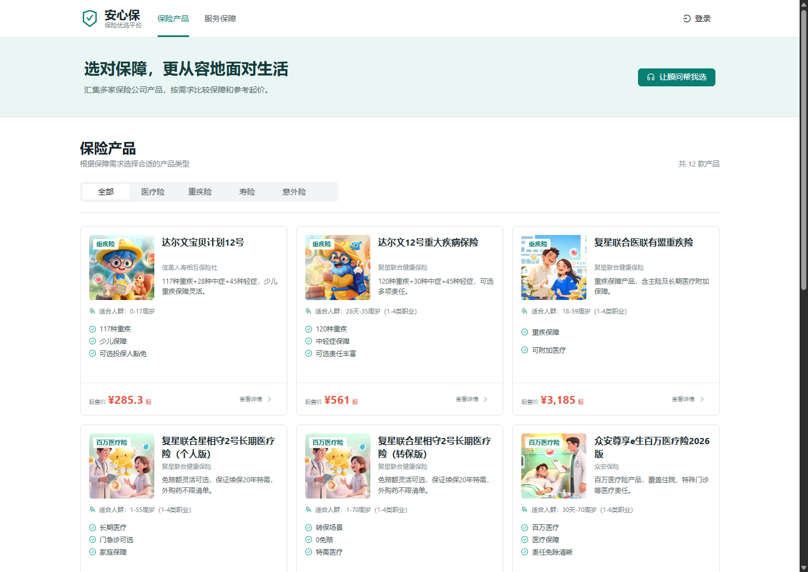
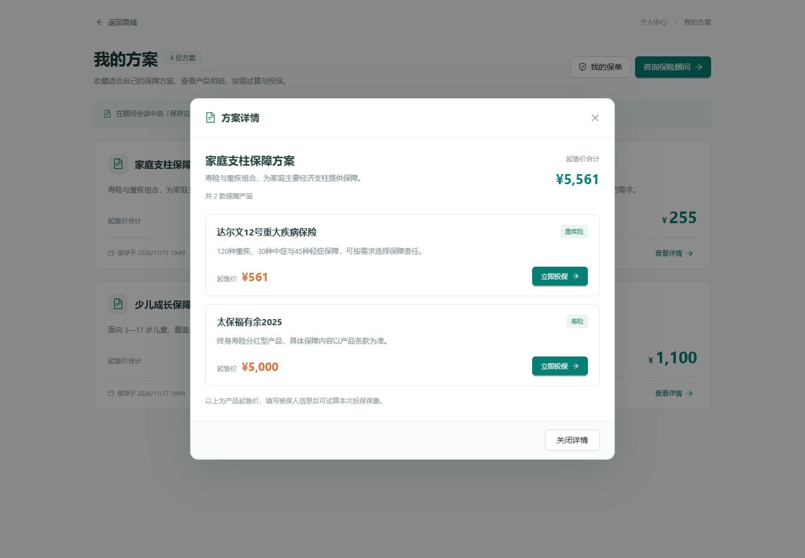
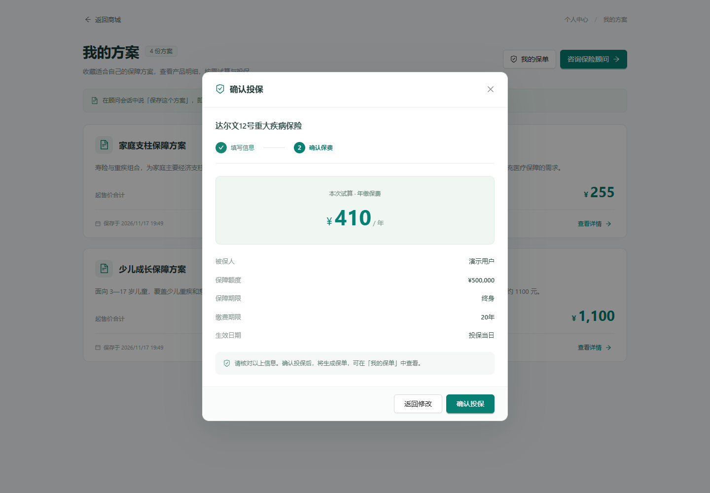
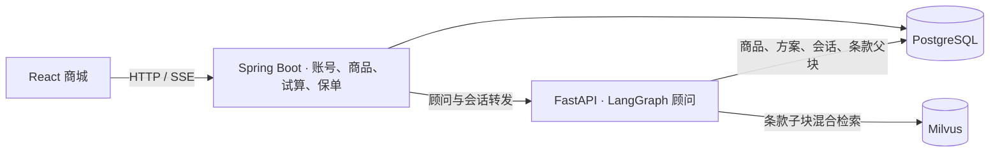

<div align="center">

# 安心保 · 保险商城

**AI 保险顾问、组合方案与投保流程演示**

Spring Boot · FastAPI · LangGraph · PostgreSQL · Milvus · React

[功能与截图](#功能与截图) · [系统设计](#系统设计) · [本地启动](#本地启动)

</div>

## 功能与截图

安心保是面向个人和家庭的保险商城。用户可以按险种浏览产品，在顾问对话里说明需求和预算、查询条款、保存组合方案，再从「我的方案」试算保费、确认投保并查看演示保单。



| 保险推荐方案 | 保费试算与确认投保 |
| :---: | :---: |
| [](docs/screenshots/plan-detail.png) | [](docs/screenshots/quote-confirm.png) |
| 在「我的方案」查看推荐组合并选择投保产品 | 填写被保人信息后，核对试算保费与保障期限 |

**AI 顾问**支持 SSE 流式对话和多轮上下文。它按需求筛选候选险种，用 RAG 检索在售产品的条款，并按用户确认保存方案。截图及保费均使用演示数据。

## 系统设计



| 功能 | 实现 |
| --- | --- |
| 顾问对话 | Java 校验 JWT 并向 Python 转发会话请求，逐块回传 SSE。LangGraph 按意图编排工具，使用 PostgreSQL Checkpointer 持久化会话状态。 |
| 条款检索 | MinerU 解析 PDF，父块存 PostgreSQL、子块存 Milvus。按产品过滤，稠密向量与 BM25 混合召回，重排后回查父块。 |
| 方案推荐 | Python 直查 PostgreSQL 筛选候选商品。保存时重新核验在售状态，并从商品表读取起售价。 |
| 试算与投保 | Java 按年龄和保额匹配示例费率，使用 `BigDecimal` 计算后保存报价快照。保单引用报价，数据库唯一约束防止同一报价重复出单。 |

## 本地启动

需要 Docker Compose、JDK 17、Maven、Node.js、Python 3.14 和 uv。以下命令以 PowerShell 为例。

**1. 启动 PostgreSQL 和 Milvus**

```powershell
git clone https://github.com/hekaihua666/insurance-mall.git
Set-Location insurance-mall
Copy-Item deploy/milvus/user.example.yaml deploy/milvus/user.yaml
docker compose -f deploy/docker-compose.yml up -d --wait postgres milvus
```

要体验完整条款检索，在启动 Milvus 前将 `deploy/milvus/user.yaml` 中的占位符替换为自己的 DashScope API Key，供重排使用。首次初始化会创建 `insurance_split` 数据库，并导入 12 款示例商品和 49 条费率。

**2. 启动 Java 和商城前端**

在两个终端中，分别从仓库根目录运行：

```powershell
Set-Location java-service
mvn spring-boot:run
```

```powershell
Set-Location frontend
npm ci
npm run dev
```

打开 [http://127.0.0.1:5173](http://127.0.0.1:5173) 浏览商品。使用页面上的注册功能创建本地演示账号。

**3. 启动 Python 顾问**

启动 Ollama，执行 `ollama pull qwen3-embedding:0.6b`。然后从仓库根目录复制 Python 配置模板：

```powershell
Copy-Item agent-service/.env.example agent-service/.env
Set-Location agent-service
uv sync --locked
uv run python -m app.main
```

运行前填写 `.env` 中的模型凭证与服务地址。要构建条款知识库，将有权使用的条款 PDF 放到 `agent-service/data/raw/kb/`，让文件名与商品表中的 `clause_name` 一致，填写 `MINERU_TOKEN`，然后在 `agent-service` 下运行 `uv run python scripts/ingest_rag.py`。首次克隆的知识库由该脚本建立。

## 代码入口

| 目录 | 内容 |
| --- | --- |
| [frontend](frontend) | React 商城、顾问聊天、方案与保单页面 |
| [java-service](java-service) | Spring Boot 业务接口、JWT 鉴权和 SSE 代理 |
| [agent-service](agent-service) | FastAPI、LangGraph、商品工具和条款检索 |
| [deploy](deploy) | PostgreSQL、Milvus 的 Compose 配置与示例 SQL |
